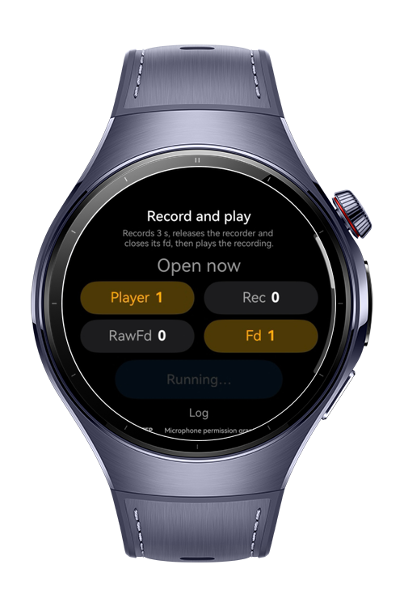
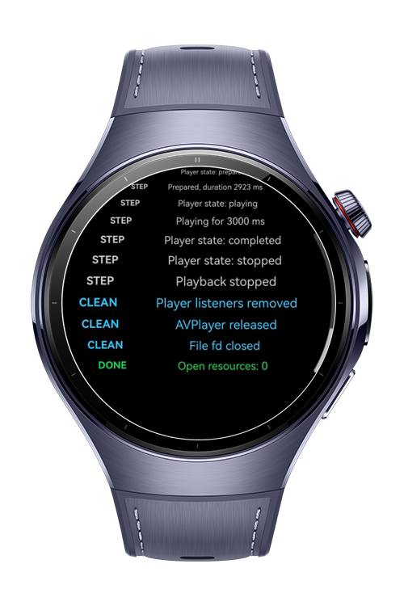
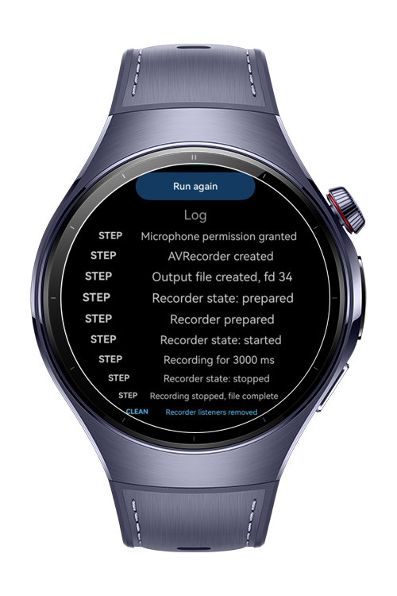
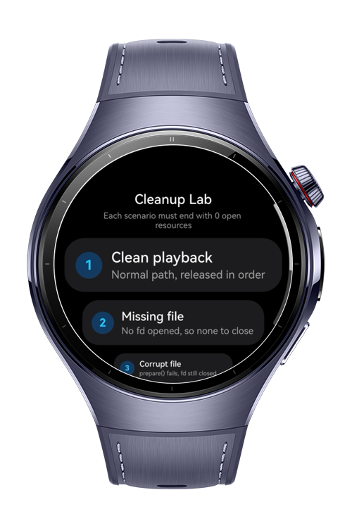

> **Note:** To access all shared projects, get information about environment setup, and view other guides, please visit [Explore-In-HMOS Index](https://github.com/Explore-In-HMOS/hmos-index).

# How To Handle Resource Cleanup In Media Operations

This codelab demonstrates how to release media resources correctly on a HarmonyOS wearable, on the success path and in every error path. Using MediaKit (`AVPlayer`, `AVRecorder`), the resource manager (`getRawFd`/`closeRawFd`) and Core File Kit (`fileIo`), the watch app runs six scenarios. Each one wraps its media work in `try`/`catch`/`finally`. The scenario screen shows live counters for open players, recorders and file descriptors, a log of every acquisition and cleanup step, and a result that is green only when every counter is back to 0.

# Preview

<div>
  
  
  
  
</div>

# Use Cases

- **Scenario list** — The home screen lists the six scenarios. Each card shows a number, a title and one line stating what the scenario proves.
- **Scenario screen** — Explains what the scenario tests, shows four live counters (Player, Rec, RawFd, Fd) that turn amber while a resource is held, and runs the scenario on tap. Each log line is tagged STEP, CLEAN or ERROR. The run ends with a green "All resources released" banner, or a red banner with the number of resources still open.
- **Clean playback** — Creates an `AVPlayer`, opens a rawfile fd, prepares, plays for 3 seconds and stops. `finally` removes the listeners, releases the player, then closes the rawfile fd. The fd is closed after the player is released because the player reads from it until then.
- **Missing file** — `getRawFd()` fails with `9001005` before any fd exists. `finally` releases the player and skips `closeRawFd()`, because closing an fd that was never opened is also a cleanup bug. A per-resource flag tells the cleanup code what was actually acquired.
- **Corrupt file** — A text file with an `.mp3` extension is opened successfully, then `prepare()` fails with `5400106`. The fd is open at this point and must be closed. The player also enters the `error` state, which starts its own release; the release in `finally` reuses it instead of running a second time.
- **Double release** — Part A calls `release()` twice on an unguarded `AVPlayer`; the second call fails with `5400102`. Part B starts two releases on a guarded session at the same time, for example a Stop tap and an error callback. Both calls share one release run, so cleanup happens exactly once.
- **Record and play** — Checks the microphone permission before creating anything, so a denial leaves nothing to clean up. Records 3 seconds to a sandbox file, then releases the recorder and closes its fd before an `AVPlayer` opens the same file for playback.
- **Failed recording** — `prepare()` fails on an invalid sample rate after the output file has been created. `finally` releases the recorder, closes the fd and deletes the incomplete file, then the app checks that no partial file is left on disk.
- **Leaving mid-run** — Swiping back from a scenario screen while it runs calls `aboutToDisappear()`, which releases every active session.
- **Audio focus and device changes** — `audioInterrupt` pauses, resumes or releases the player depending on the hint. `audioOutputDeviceChangeWithInfo` pauses playback when the output device disconnects.

# Technology

## Stack

- **Language**: ArkTS
- **UI Framework**: ArkUI (Stage Model)
- **Tools**: DevEco Studio 6.0.0 or later
- **Libraries & Kits**:
    - `@kit.MediaKit` — `AVPlayer` and `AVRecorder` creation, state handling, `reset()`/`release()`
    - `@kit.AudioKit` — audio interruption and output device change types
    - `@kit.CoreFileKit` — `fileIo.open`/`close`/`unlinkSync`/`accessSync` for the recording file
    - `@kit.LocalizationKit` (via `context.resourceManager`) — `getRawFd()`/`closeRawFd()`, `getStringByNameSync()`
    - `@kit.AbilityKit` — `abilityAccessCtrl` runtime permission request
    - `@kit.ArkUI` — `ArcList`/`ArcListItem` for the round display, `Navigation`/`NavPathStack` for the scenario screens
    - `@kit.PerformanceAnalysisKit` — `hilog` mirror of the on-screen log

## Required Permissions

- `ohos.permission.MICROPHONE`
  > Needed by scenarios 5 and 6 to record audio. Requested at runtime (`user_grant`) before the recorder is created.

# Directory Structure

```
entry/src/main/
├── ets/
│   ├── common/
│   │   ├── Constants.ets          // Rawfile names, timings, error codes, PlayerState/RecorderState enums
│   │   ├── Logger.ets             // hilog wrapper
│   │   └── TimeUtils.ets          // delay()
│   ├── components/
│   │   ├── ResourceChip.ets       // Live counter for one resource type
│   │   ├── ScenarioCard.ets       // Home list card
│   │   └── ScenarioDetail.ets     // Scenario screen: description, counters, Run, result, log
│   ├── entryability/
│   │   └── EntryAbility.ets
│   ├── model/
│   │   ├── CleanupError.ets       // App-defined error with a code; Releasable interface
│   │   ├── CleanupLog.ets         // Log resolved from string.json, mirrored to hilog
│   │   ├── ResourceTracker.ets    // Counts open players, recorders and fds
│   │   └── Scenario.ets           // Scenario list with titles, summaries and descriptions
│   ├── pages/
│   │   └── Index.ets              // Navigation host and scenario list
│   └── service/
│       ├── PermissionHelper.ets   // Microphone permission check and request
│       ├── PlaybackSession.ets    // AVPlayer + fd, idempotent ordered release
│       ├── RecordingSession.ets   // AVRecorder + fd + output file, deletes incomplete files
│       └── ScenarioRunner.ets     // try/catch/finally for each scenario, error hints
├── resources/
│   ├── base/
│   │   ├── element/               // string.json, color.json, float.json
│   │   ├── media/                 // icon.png, startIcon.png
│   │   └── profile/main_pages.json
│   └── rawfile/
│       ├── sample_tone.wav        // Valid 5 s audio for playback scenarios
│       └── corrupt_audio.mp3      // Text data with an .mp3 extension, used by the corrupt file scenario
└── module.json5
```

# Constraints and Restrictions

## Supported Device

- Huawei Watch 5

### Minimum API Version

| API | Min version |
|---|---|
| `AVPlayer`, `AVRecorder` | Wearable 18 |
| `fileIo.open`/`close`/`closeSync`/`unlinkSync` | Wearable 20 |

The project targets API 20 because the recorder output fd comes from `fileIo`, which is available on Wearable from API 20.

### Corrupt File Error Code

Scenario 3 expects `prepare()` to fail with `5400106` (unsupported format). The exact code and whether the `error` state is reported first can vary by firmware. The cleanup result is the same either way: the fd is closed and the player is released once.

### Microphone Permission

If the permission is denied, the Record and play and Failed recording scenarios stop before creating any recorder or file and log that there is nothing to clean up. To test those scenarios again after a denial, grant the permission in the watch settings.

# License

**How To Handle Resource Cleanup In Media Operations** is distributed under the terms of the MIT License. See the [LICENSE](LICENSE) for more information.
